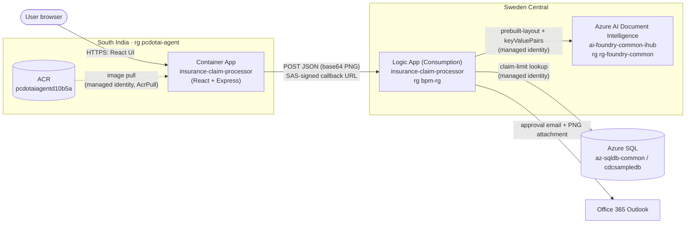
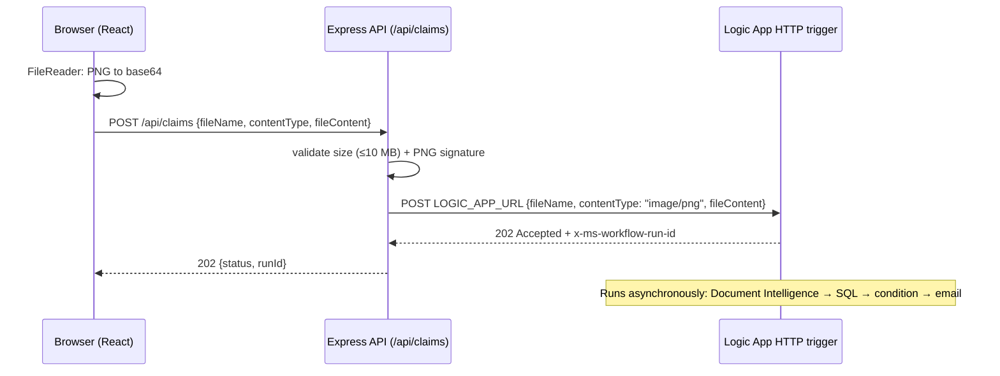

# Insurance Claim Processor

A small web app for submitting health-insurance claim forms. The user picks a scanned claim form
(`.png`) and clicks **Submit**. The file goes to an Azure Logic App, which:

1. extracts the claim details with Azure AI Document Intelligence;
2. checks the claimed amount against the policy's limit in Azure SQL;
3. emails the claim, with the original image attached, to an approver.

The web app only uploads the file. All document processing runs in the Logic App.

**Live app:** <https://insurance-claim-processor.whitemoss-1ee70859.southindia.azurecontainerapps.io/>

---

## Contents

- [Architecture](#architecture)
- [Azure resources](#azure-resources)
- [Web app](#web-app)
- [Logic App: `insurance-claim-processor`](#logic-app-insurance-claim-processor)
- [How the web app calls the Logic App](#how-the-web-app-calls-the-logic-app)
- [Run locally](#run-locally)
- [Deploy to Azure Container Apps](#deploy-to-azure-container-apps)
- [Operations](#operations)
- [Security considerations & known limitations](#security-considerations--known-limitations)

---

## Architecture



---

## Azure resources

### Created for this project

| Resource | Type | Resource group / region | Purpose |
|---|---|---|---|
| `insurance-claim-processor` | Azure Container App | `pcdotai-agent` / South India | Hosts the web app: the React UI plus a small Express API that forwards uploads to the Logic App. Public HTTPS on port 3001. Consumption profile, 0.5 vCPU / 1 GiB, scales 0–2 replicas. Has a system-assigned managed identity. |
| `insurance-claim-processor` (repository) | Container image in ACR `pcdotaiagentd10b5a` | `pcdotai-agent` / South India | The container image, built remotely with ACR Tasks (`az acr build`). |
| `logic-app-url` | Container App secret | on the container app | Holds the Logic App's SAS-signed HTTP trigger URL, exposed to the container as the `LOGIC_APP_URL` environment variable. |
| **AcrPull** role assignment | RBAC | scope: ACR `pcdotaiagentd10b5a` | Lets the container app's managed identity pull images, so no registry password is stored. |
| **Cognitive Services User** role assignment | RBAC | scope: `ai-foundry-common-ihub` | Lets the Logic App's managed identity call Document Intelligence without keys. |

### Existing resources the solution uses

| Resource | Type | Resource group / region | Role in the solution |
|---|---|---|---|
| `pcdotai-agent` | Container Apps environment | `pcdotai-agent` / South India | Shared hosting environment (Consumption profile, no custom VNet, logs to Log Analytics). Also hosts the unrelated `workiq-relay` app; each app has its own replicas, resources, scaling and domain name. |
| `pcdotaiagentd10b5a` | Azure Container Registry (Basic) | `pcdotai-agent` / South India | Stores the web app image. |
| `insurance-claim-processor` | Logic App (Consumption) | `bpm-rg` / Sweden Central | Claim-processing workflow ([details below](#logic-app-insurance-claim-processor)). Uses a system-assigned managed identity. |
| `formrecognizer-1` | API connection (Form Recognizer) | `bpm-rg` | Logic App → Document Intelligence at `https://ai-foundry-common-ihub.cognitiveservices.azure.com/` (managed identity auth). |
| `ai-foundry-common-ihub` | Azure AI Foundry / AI Services | `rg-foundry-common` / Sweden Central | Provides Azure AI Document Intelligence (`prebuilt-layout` model). |
| `sql` | API connection (SQL Server) | `bpm-rg` | Logic App → Azure SQL (managed identity auth). |
| `az-sqldb-common` / `cdcsampledb` | Azure SQL server / database | `az-sqldb-common-rg` | Table `HealthInsuranceClaims` holds the `ClaimLimit` for each `PolicyNumber` + `ClaimType`. |
| `office365` | API connection (Office 365 Outlook) | `bpm-rg` | Sends the approval email (authenticated as a user account). |

---

## Web app

| Layer | Tech | Location |
|---|---|---|
| UI | React 19 + Vite | [`src/`](src/) |
| API / static host | Node.js + Express 5 | [`server/index.js`](server/index.js) |
| Container | Multi-stage `node:22-alpine`, runs as non-root `node` user | [`Dockerfile`](Dockerfile) |

**UI** ([`src/App.jsx`](src/App.jsx)):

- file picker restricted to `.png`, with an image preview;
- **Submit** reads the file as base64 and POSTs it to `/api/claims`;
- shows a success message with the Logic App **run ID**, or an error.

**API**: `POST /api/claims` ([`server/index.js`](server/index.js))

- Request: `{ "fileName": "PolicyClaim-21.png", "contentType": "image/png", "fileContent": "<base64>" }`
- Validation: `fileContent` is required, the decoded file is at most 10 MB, and it must start with the PNG file signature (the extension alone isn't trusted).
- Forwards the file to the Logic App (see [below](#how-the-web-app-calls-the-logic-app)).
- Response: `202 { "status": 202, "runId": "<logic app run id>" }`. Returns `400`/`413` for invalid input and `502` if the Logic App can't be reached or returns an error.
- In production it also serves the built UI from `dist/`.

**Configuration** (environment variables):

| Variable | Required | Description |
|---|---|---|
| `LOGIC_APP_URL` | yes | HTTP trigger callback URL of the Logic App. **Secret:** it contains a SAS signature. |
| `PORT` | no (default `3001`) | Port the Express server listens on. |

Locally these come from `.env` (loaded with Node's `process.loadEnvFile`). In Azure they come from Container App settings.

```
.
├── data/PolicyClaim-21.png   # sample claim form for testing
├── server/index.js           # Express API + static file host
├── src/                      # React UI (main.jsx, App.jsx, App.css)
├── index.html                # Vite entry
├── vite.config.js            # dev server on :5173, proxies /api -> :3001
├── Dockerfile / .dockerignore
└── .env.example              # template for local configuration
```

---

## Logic App: `insurance-claim-processor`

Consumption Logic App in `bpm-rg` (Sweden Central). It has a system-assigned managed identity, which
it uses for Document Intelligence and SQL.

### Trigger: `When_an_HTTP_request_is_received`

HTTP **POST** request trigger, secured by the SAS signature (`sig`) in its callback URL. Request body schema:

```json
{
  "type": "object",
  "properties": {
    "fileName":    { "type": "string" },
    "contentType": { "type": "string" },
    "fileContent": { "type": "string", "description": "Base64-encoded file content" }
  },
  "required": ["fileContent"]
}
```

The workflow has no Response action, so the trigger returns **`202 Accepted`** right away. The run ID
is in the `x-ms-workflow-run-id` response header, and processing continues asynchronously.

### Actions

| # | Action | Type | What it does |
|---|---|---|---|
| 1 | `Analyze_Document` | Form Recognizer connector: *Analyze Document (v4.0)* | Sends `fileContent` (as `contentType`, default `image/png`) to Document Intelligence model **`prebuilt-layout`**, API `2024-11-30`, with `features=keyValuePairs`. Returns the text, layout and detected *key: value* pairs. |
| 2 | `Normalize_Key_Value_Pairs` | Select | Turns each pair into `{ key, value }`, with the key lower-cased and stripped of `:` and whitespace (for example `"Policy Number:"` becomes `"policy number"`). |
| 3 | `Filter_Name`, `Filter_Date_of_Birth`, `Filter_Policy_Number`, `Filter_Type_of_Service`, `Filter_Amount_Claimed` | Filter array (run in parallel) | Pick out the pairs for each claim field. |
| 4 | `Extracted_Claim_Data` | Compose | Builds the claim JSON (see mapping below). |
| 5 | `Parse_JSON` | Parse JSON | Makes the claim fields available as typed tokens to the later steps. |
| 6 | `Execute_a_SQL_query_(V2)` | SQL connector | `SELECT ClaimLimit FROM HealthInsuranceClaims WHERE PolicyNumber = '<policy_number>' AND ClaimType = '<type_of_service>'` on `az-sqldb-common.database.windows.net` / `cdcsampledb`. |
| 7 | `Initialize_variable` | Initialize variable | `amount_claimed` (float) = the text after the first space in `amount_claimed` (for example `"Rs. 5000"` gives `5000`). |
| 8 | `Condition` | If | **If** `amount_claimed < ClaimLimit` → run `Send_an_email_(V2)_2`. **Else**: no action. |
| 8a | `Send_an_email_(V2)_2` | Office 365 Outlook: *Send an email (V2)* | To **sansri@microsoft.com**. Subject `Insurance claim with Policy Number <policy_number> for your approval`. The HTML body lists all extracted fields plus the SQL claim limit. **The uploaded PNG is attached**, named after `fileName`, or `claim-<policy_number>.png` if no name was sent. |

### Extracted claim JSON

The form lists patient details before policyholder details. So for the repeated keys (`Name`,
`Date of Birth`), the **first** match is the patient and the **last** is the policyholder.

| Field | Source key on the form | Example |
|---|---|---|
| `policy_number` | Policy Number | `ABCD123456789` |
| `patient_name` | first *Name* | `John Smith` |
| `patient_dob` | first *Date of Birth* | `01/01/1990` |
| `policyholder_name` | last *Name* | `John Smith` |
| `policyholder_dob` | last *Date of Birth* | `01/01/1990` |
| `type_of_service` | Type of Service | `Outpatient Consultation` |
| `amount_claimed` | Amount Claimed | `Rs. 5000` |

---

## How the web app calls the Logic App



- The browser never sees the Logic App URL. Only the server holds it, because the `sig` parameter
  acts as a password for the trigger.
- The web app doesn't wait for the claim to finish processing. It only confirms the Logic App
  accepted the run. Check the outcome in the Logic App's **run history**, or in the approver's inbox.

---

## Run locally

**Prerequisites**

- Node.js **22.12+** (or 20.19+), as required by Vite 8
- Azure CLI signed in (`az login`) with read access to the Logic App, to fetch its callback URL

**Steps**

```powershell
cd insurance-claim-processor
npm install

# Create .env with the Logic App callback URL
$url = az rest --method post `
  --url "https://management.azure.com/subscriptions/<subscription-id>/resourceGroups/bpm-rg/providers/Microsoft.Logic/workflows/insurance-claim-processor/triggers/When_an_HTTP_request_is_received/listCallbackUrl?api-version=2019-05-01" `
  --query value -o tsv
Set-Content .env "LOGIC_APP_URL=$url`nPORT=3001"

npm run dev
```

- UI: <http://localhost:5173> (Vite dev server with hot reload; proxies `/api` to the Express server)
- API: <http://localhost:3001>

Open the UI, pick [`data/PolicyClaim-21.png`](data/PolicyClaim-21.png) and click **Submit**.

**Production-like local run** (single process, serves the built UI):

```powershell
npm run build
npm start          # http://localhost:3001
```

**Run the container locally** (optional, needs Docker):

```powershell
docker build -t insurance-claim-processor .
docker run --rm -p 3001:3001 --env-file .env insurance-claim-processor
```

---

## Deploy to Azure Container Apps

**Prerequisites**

- Azure CLI with the `containerapp` extension (`az extension add -n containerapp --upgrade`)
- On subscription `bc2e2415-164d-45a5-9a4a-29d9264a343e`:
  - push access to ACR `pcdotaiagentd10b5a`;
  - Contributor on resource group `pcdotai-agent`;
  - permission to create role assignments, for the `AcrPull` grant.

Set some variables first:

```powershell
$rg   = "pcdotai-agent"
$acr  = "pcdotaiagentd10b5a"
$app  = "insurance-claim-processor"
$tag  = "v1"
$env:PYTHONUTF8 = 1   # stops az acr build crashing on non-ASCII log output on Windows consoles
```

### 1. Build the image remotely in ACR

Run from the project root. The build context is uploaded, and `.dockerignore` keeps out `.env`,
`node_modules` and `data/`.

```powershell
az acr build -r $acr -g $rg -t "${app}:$tag" -t "${app}:latest" --platform linux/amd64 .
```

If log streaming fails locally, the build still continues in ACR. Check it with
`az acr task list-runs -r $acr --top 1 -o table`.

### 2a. First-time deployment: create the container app

```powershell
$url = "<Logic App callback URL>"   # see "Run locally" for how to get it

az containerapp create -g $rg -n $app --environment pcdotai-agent `
  --image "$acr.azurecr.io/${app}:$tag" `
  --registry-server "$acr.azurecr.io" --registry-identity system --system-assigned `
  --workload-profile-name Consumption --cpu 0.5 --memory 1Gi --min-replicas 0 --max-replicas 2 `
  --ingress external --target-port 3001 `
  --secrets "`"logic-app-url=$url`"" `
  --env-vars "LOGIC_APP_URL=secretref:logic-app-url"
```

> **Windows note:** the URL contains `&`. `az` on Windows runs through `cmd.exe`, so the secret
> argument is wrapped in escaped quotes (`` "`"...`"" ``) to keep the URL in one piece. In bash, use
> `--secrets "logic-app-url=$url"`.

`--registry-identity system` enables the app's system-assigned identity and grants it **AcrPull** on the registry.

### 2b. Later releases: update the image

```powershell
az containerapp update -g $rg -n $app --image "$acr.azurecr.io/${app}:$tag"
```

### 3. Verify

```powershell
az containerapp show -g $rg -n $app --query "{fqdn:properties.configuration.ingress.fqdn, status:properties.runningStatus}" -o json
az containerapp revision list -g $rg -n $app -o table
```

Browse to the FQDN, submit the sample PNG, and check that a new **Succeeded** run appears in the
Logic App run history.

---

## Operations

| Task | Command / location |
|---|---|
| Stream app logs | `az containerapp logs show -g pcdotai-agent -n insurance-claim-processor --follow` |
| Logic App run history | Azure portal → `bpm-rg` → `insurance-claim-processor` → **Run history** (search by the run ID shown in the UI) |
| Keep one replica warm (no cold start) | `az containerapp update -g pcdotai-agent -n insurance-claim-processor --min-replicas 1` |
| Rotate the Logic App URL | See below |

**Rotate the Logic App URL.** Regenerate the Logic App access key (portal → **Settings → Access
keys**), fetch the new callback URL (see [Run locally](#run-locally)), then:

```powershell
az containerapp secret set -g pcdotai-agent -n insurance-claim-processor --secrets "`"logic-app-url=$url`""
$rev = az containerapp show -g pcdotai-agent -n insurance-claim-processor --query properties.latestRevisionName -o tsv
az containerapp revision restart -g pcdotai-agent -n insurance-claim-processor --revision $rev
```

---

## Security considerations & known limitations

- **Public, unauthenticated UI.** Anyone with the URL can submit a claim, which uses Document
  Intelligence capacity and sends an approval email. For anything beyond a demo, enable Container Apps
  built-in authentication (Microsoft Entra ID).
- **SQL query is built by string concatenation** from values read off the uploaded document. Since
  the document is user-supplied, switch to a parameterized query or stored procedure before
  production use.
- **Treat the callback URL as a secret.** It's kept out of source control (`.env` is git-ignored)
  and out of the image (`.dockerignore`). In Azure it's a Container App secret.
- **Extraction assumptions:** first *Name* / *Date of Birth* = patient and last = policyholder;
  `amount_claimed` must look like `<currency> <number>` (for example `Rs. 5000`). Forms with a
  different layout may need changes to the mapping.
- **No action when the claim is at or over the limit.** The `Condition` else branch is empty, and
  the approver address is hard-coded in the Logic App.
- **Fire-and-forget.** The UI confirms that the run was *accepted*, not that the claim was approved or the email sent.
